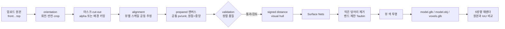

# sixview — 5면 정투영 이미지 → 3D 메시

실제 촬영각이 다른 사진의 공통 카메라·보호 보정 경로가 추가됐다. 사용 순서, 상태/단위 계약, 실행한 검증과 남은 실제 사진 검증은 [사진 보정 구현 기록](CAMERA_RECONSTRUCTION.md)을 참고한다. 아래 정투영 설명은 `reference` 모드에 해당하며, 실제 사진 모드는 사진별 카메라와 고정 초기 형상을 사용한다.

front · back · left · right · top 5장의 정투영 이미지를 하나의 고정 좌표계에 정렬하고, 정렬이 맞는지 먼저 검증한 뒤, 5개 실루엣의 교집합(visual hull)을 매끈한 메시로 만든다. 결과는 다시 5방향으로 렌더해 입력과 겹쳐 비교한다.

## 실행

```bash
npm install
npm run cad:install && npm run cad:build   # 웹 화면(studio/viewer) 빌드
node src/cli.ts serve --dir work --port 5173
# http://127.0.0.1:5173/        5면 입력·방향/정렬 보정·검증·3D 생성
# http://127.0.0.1:5173/viewer  3D 미리보기
```

CLI만으로도 같은 파이프라인을 쓴다.

```bash
node src/cli.ts analyze <dir>                 # 정렬 품질만 검사
node src/cli.ts build   <dir> [--res 160] [--symmetry] [--smoothing 12] [--out <dir>]
```

`<dir>`에는 `front.png` `back.png` `left.png` `right.png` `top.png`(jpg/webp도 가능)를 두고, 웹에서 저장한 보정값 `views.json`이 있으면 그대로 적용된다.

## 월드 좌표계 (고정)

| 축 | 의미 |
|---|---|
| +X / -X | 물체의 오른쪽 / 왼쪽 |
| +Y / -Y | 위 / 아래 |
| +Z / -Z | 물체의 앞(front) / 뒤(back) |

| 뷰 | 카메라 위치 | 이미지 위쪽 | 이미지 오른쪽 |
|---|---|---|---|
| front | +Z | +Y | +X |
| back | -Z | +Y | -X |
| left | -X | +Y | +Z |
| right | +X | +Y | -Z |
| top | +Y | -Z | +X |

top에서는 화면 위가 물체의 뒤(-Z), 화면 아래가 앞(+Z)이다. left에서는 앞이 화면 오른쪽, right에서는 화면 왼쪽이다.

이 표의 유일한 출처는 `src/render/basis.ts`의 `BASES`(right/up/forward 벡터)다. 렌더러, 복원, 검증, 웹 화면의 방향 마커(`imageAxes`)가 모두 같은 벡터를 읽는다. 따라서 표와 코드가 어긋날 수 없다.

## 파이프라인



## 모듈

| 파일 | 역할 |
|---|---|
| `src/views.ts` | 뷰 설정: `VIEW_IDS`, 뷰별 측정 축, 필수 여부, mirror 쌍, `imageAxes()` |
| `src/render/basis.ts` | 뷰별 카메라 기저 벡터(좌표계 정의의 유일한 출처) |
| `src/orientation.ts` | 사용자 보정 `ViewTransform`(rotation 0/90/180/270, flip, scale, offset, crop) 저장·검증, `views.json` |
| `src/preprocess.ts` | 회전/반전/crop → 마스크·cut-out → 공통 캔버스 배치 → 실루엣 재측정. `prepared/*.png`, 외곽선 PNG |
| `src/alignment.ts` | 뷰마다 다른 확대율을 log 최소제곱으로 공동 추정하고, 잔차로 90° 회전 의심 뷰를 찾는다 |
| `src/analyze/silhouette.ts` | alpha 또는 테두리 flood-fill 배경 키잉으로 실루엣 추출, bbox·덩어리 수 |
| `src/validation.ts` | 정렬 품질 점수: 축 비율 일관성, 뷰 일치도(거친 hull 재투영), 중심 정렬(축별 1D 점유 구간), 실루엣 대칭, 입력 상태 |
| `src/reconstruct/voxel-reconstruct.ts` | 뷰별 2D signed distance(정확한 EDT)의 최솟값으로 만든 hull 거리장, 좌우 대칭 prior, 곡면 보정(수평 단면을 front 폭 × side 깊이에 내접하는 타원으로 제한 — 웹의 "캐릭터" 선택 시 1, "자동차·제품" 선택 시 0) |
| `src/reconstruct/mesh-extract.ts` | Surface Nets(거리장 영점 보간) 메시, 복셀 메시 |
| `src/reconstruct/mesh-postprocess.ts` | 작은 연결 성분 제거, 변위를 셀 0.6배로 제한한 Taubin 스무딩 |
| `src/reconstruct/finish.ts` | 깊이 테스트를 거친 다중 뷰 색 투영, 보이지 않는 면 채우기, (생성형 경로) 비율 보정 |
| `src/render/ortho.ts` | 정투영 래스터라이저. `pixelsPerUnit`를 주면 prepared 캔버스와 픽셀 단위로 정렬된다 |
| `src/mesh/glb.ts`, `obj.ts` | GLB(법선·정점색) / OBJ 내보내기 |
| `src/pipeline.ts` | `reconstructFromViews`(메인), `runFromViews`(선택: 생성형 공급자) |
| `src/web/server.ts` | studio JSON API, 파일 서빙, 작업 직렬화 |
| `cad/src/studio/` | 5면 입력 화면: 방향 마커, 중심선·bbox·외곽선, 회전/반전/보정, 품질 점수, 생성 방식(물체 종류), 재투영 비교(외곽 IoU + 색 일치도 + 색 충돌 렌더, AI 보정 전/후) |
| `src/reconstruct/ai-correct.ts` | AI 형상을 5면 프레임에 맞추기(4방향 회전 선택, 축별 크기·위치), hull 밖 부분의 부드러운 보정 |
| `cad/src/viewer/` | 3D 뷰어: orbit, wireframe, flat/smooth, mesh↔voxel, bbox, XYZ gizmo, front/back/left/right/top 프리셋, 바닥 방향 표시 |

## 정렬 검증

검증은 생성 전에 돌고, UI 보정값을 바꿀 때마다 다시 계산된다.

- **축 비율 일관성:** 뷰마다 확대율 하나만 자유롭게 두고 공유 축(X: front/back/top, Y: front/back/left/right, Z: left/right/top)을 맞춘다. 그래도 남는 오차는 진짜 불일치다. 가로·세로를 바꿨을 때 오차가 크게 줄면 "90° 회전 의심"으로 표시한다.
- **뷰 일치도:** 해상도 64의 거친 hull을 만들어 각 뷰로 다시 투영하고, 각 실루엣이 얼마나 살아남는지 IoU로 잰다. 가장 나쁜 뷰가 점수를 정한다. 뷰 하나가 틀리면 나머지 뷰까지 깎아 내기 때문이다.
- **중심 정렬:** 같은 축을 보는 뷰들의 1D 점유 구간이 몇 % 어긋나는지 잰다.
- **실루엣 대칭:** front↔back, left↔right의 거울상 IoU를 잰다.
- **입력 상태:** 다음 경우를 잡는다.
  - 뷰 누락(top이 없으면 생성 차단)
  - alpha 없음(배경 키잉으로 대체)
  - 원본 가장자리에서 잘린 피사체
  - 너무 작은 이미지(256px 미만)
  - 보정 후 캔버스 밖으로 나간 경우

## 결과 검증: 외곽 일치도와 색 일치도

결과 메시는 입력과 같은 px/unit으로 5방향 재렌더되어 두 가지로 채점된다.

- **외곽 일치도 (IoU):** 입력 실루엣과 재렌더 실루엣의 겹침. 외곽선이 맞는지 본다.
- **색 일치도 (photo-consistency):** 두 장 이상의 사진이 함께 정면으로 보는 표면점마다, 사진들이 그 점의 색에 동의하는지 본다. 밝기 차이(같은 흰 면의 음영)는 절반만 반영하고, 색상 차이(흰 얼굴 vs 분홍 꽃)는 그대로 반영한다(`colourDistance`). 동의하지 않는 점은 `result/<view>.conflict.png`에 빨갛게 표시된다.

외곽 일치도가 높은데 색 일치도가 낮으면, 외곽선은 맞지만 형상 안쪽이 실제와 다르다는 뜻이다. 예: 키티의 꽃이 앞면·옆면·정수리에 따로 찍힘(외곽 96%, 색 78%). 정확한 형상(내장 데모 의자)은 둘 다 98~100%다.

## 생성 방식: 실루엣 vs AI + 실루엣 보정

| 방식 | 언제 | 무엇을 하나 |
|---|---|---|
| `silhouette` (웹: 자동차·제품) | 외곽선이 곧 형상인 물체 | 위의 hull 거리장 → Surface Nets → 스무딩. 몇 초, 오프라인 |
| `ai` (웹: 캐릭터, 기본) | 볼·코·튀어나온 부품처럼 외곽선 안쪽에 형상이 있는 물체 | 정렬된 front/back/left/right를 Hunyuan3D-2mv에 보내 형상을 받고 → `fitToViews`: 4방향 회전 중 실루엣이 가장 잘 맞는 방향 선택, 축별 크기·위치를 열림 연산(수염 같은 가는 부분 제외)한 외곽선 폭에 맞춤 → `correctToHull`: 5면 hull 밖으로 2.5셀 넘게 나간 부분의 변위를 표면 전체로 확산시켜 부드럽게 밀어 넣음(평평한 단면 없이) → 뷰 색 투영 |

`ai`는 인터넷과 HF Space가 필요하며 30초~1분 걸린다. 실패하면 자동으로 `silhouette`로 만들고 경고를 남긴다. 보정 전 형상은 `ai-raw.glb`로 함께 저장되어, 결과 화면과 뷰어에서 보정 전/후를 비교할 수 있다.

키티 샘플(5면, 160): 실루엣 외곽 96 · 색 78 → AI 원본 외곽 91 · 색 82 → 보정 후 외곽 92 · 색 81. 외곽은 실루엣 방식이 가장 정확하고, 볼·코·꽃 같은 입체는 AI 방식만 만든다.

## 왜 이전보다 깔끔한가

1. **방향이 데이터에 묶여 있다.** 각 뷰의 위·오른쪽이 월드 축으로 정의되고 화면에 표시된다. 잘못 돌아간 뷰는 생성 전에 오류로 잡힌다. 이전에는 top이 90° 돌아간 채로도 3D가 만들어졌다.
2. **배율을 자동으로 맞춘다.** 뷰마다 다른 확대율(예: front만 2.7배 확대)을 공동 추정해 하나의 px/unit으로 맞춘다. 이전에는 이것이 46% 치수 오차로 나타났다.
3. **복셀 on/off가 아니라 거리장이다.** hull을 이진 복셀이 아닌 연속 거리장으로 만들고 영점을 보간해 표면을 뽑는다. 계단이 생기지 않고, 실루엣이 셀보다 작은 정밀도로 재현된다.
4. **스무딩이 실루엣을 지킨다.** Taubin은 수축이 없고, 각 정점의 이동은 셀 0.6배로 제한된다. 매끈해지면서도 재투영 IoU가 유지된다(F1 샘플 기준 96~99%).
5. **top이 필수다.** 길이·폭·콕핏·윙 형상을 윗면 실루엣이 직접 깎는다.

남는 한계: visual hull은 어느 실루엣에도 드러나지 않는 오목부(콕핏 안쪽, 바퀴 사이 틈의 일부)를 채운다. 실루엣만으로는 원리적으로 복원할 수 없는 부분이다.

## 뷰 추가(예: bottom)

1. `src/views.ts`의 `VIEW_IDS`에 `"bottom"`을 넣는다.
2. `VIEWS`에 `{ widthAxis: "x", heightAxis: "z", required: false }`를 넣고, top과 mirror 쌍으로 묶는다.
3. `src/render/basis.ts`의 `BASES`에 `bottom: { right: [1,0,0], up: [0,0,1], forward: [0,1,0] }`을 넣는다.

정렬, 검증, 복원, 재렌더, 웹 슬롯과 방향 마커는 이 표들을 순회하므로 다른 수정은 필요 없다.

## 샘플 데이터

```bash
node src/cli.ts demo --out samples/demo     # 내장 형상을 5방향으로 정확히 렌더한 입력
node src/cli.ts build samples/demo --res 128
node src/cli.ts serve --dir samples/demo    # 웹에서 회전·보정·생성 실험
```

일부러 틀린 입력도 만들어 볼 수 있다. 예를 들어 top 이미지를 90° 돌려 저장한 뒤 웹을 열면, "top 뷰가 90° 돌아가 있을 가능성" 오류가 뜨고 ⟲ 버튼으로 해결되는 것을 확인할 수 있다. 같은 시나리오가 `test/analyze.test.ts`에 테스트로 들어 있다.
